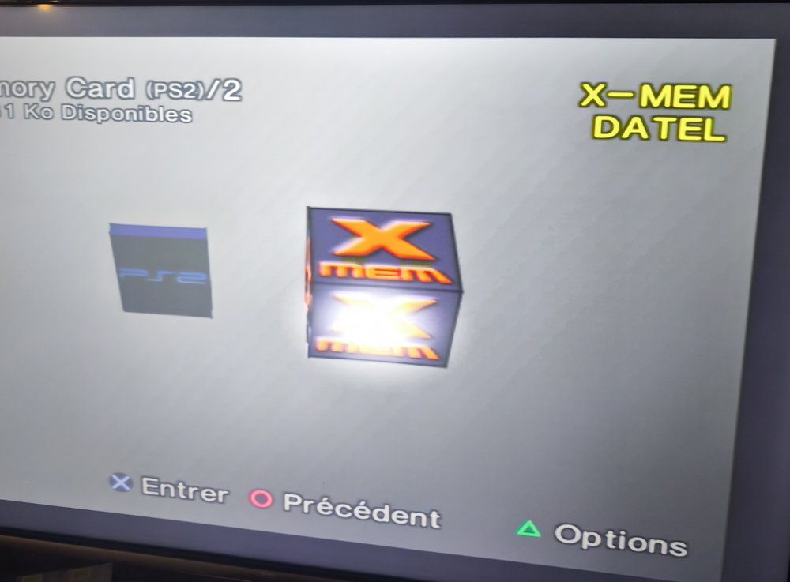
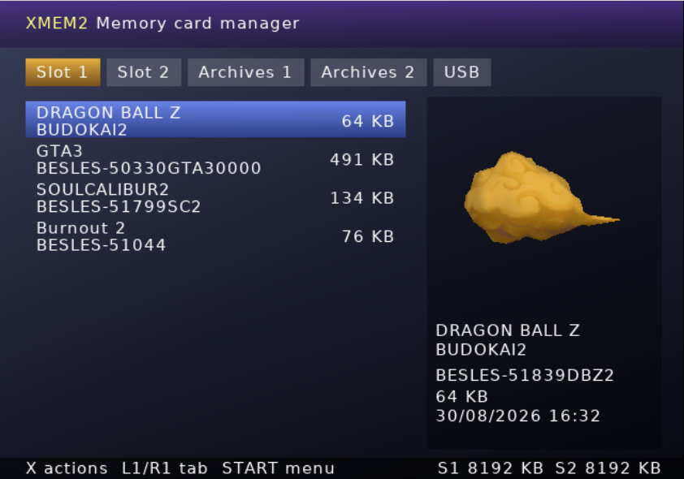
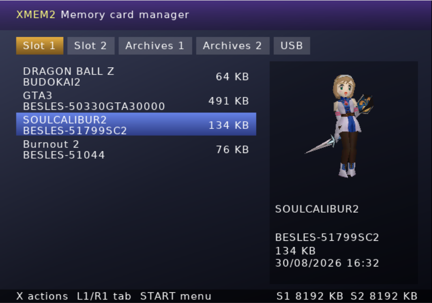
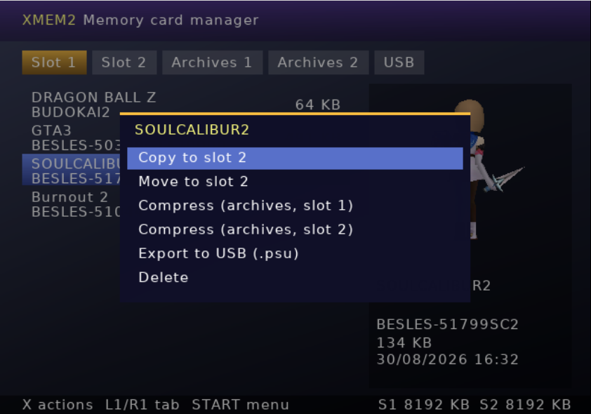
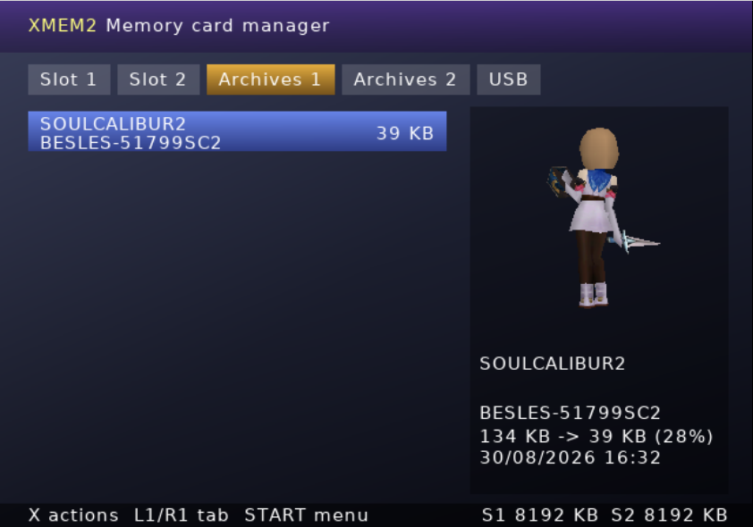
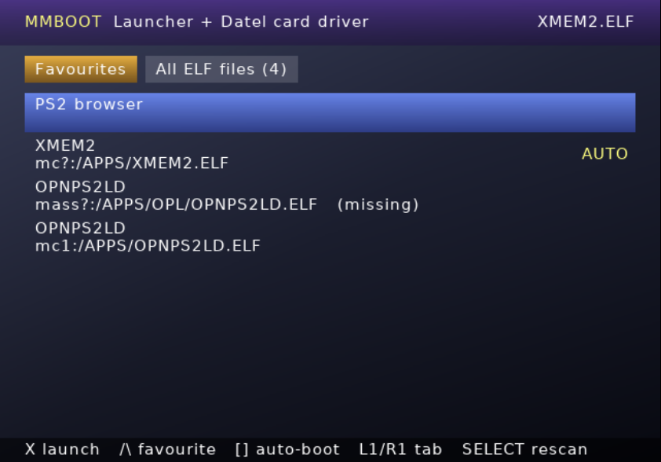
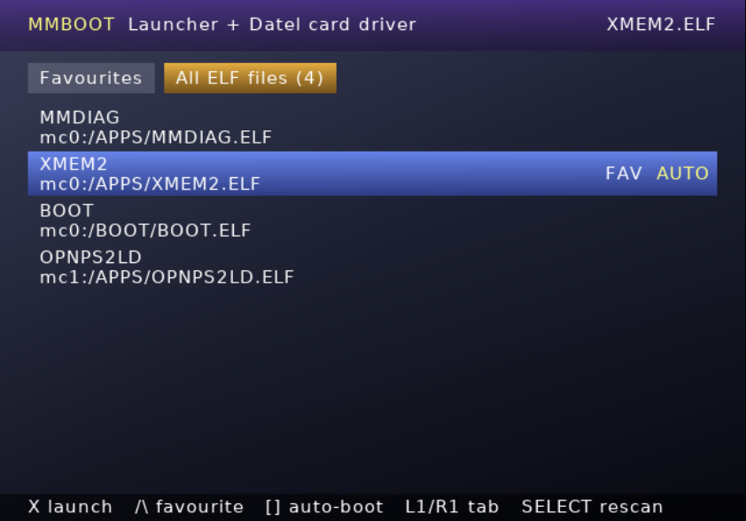
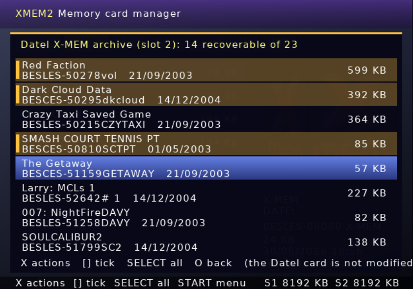
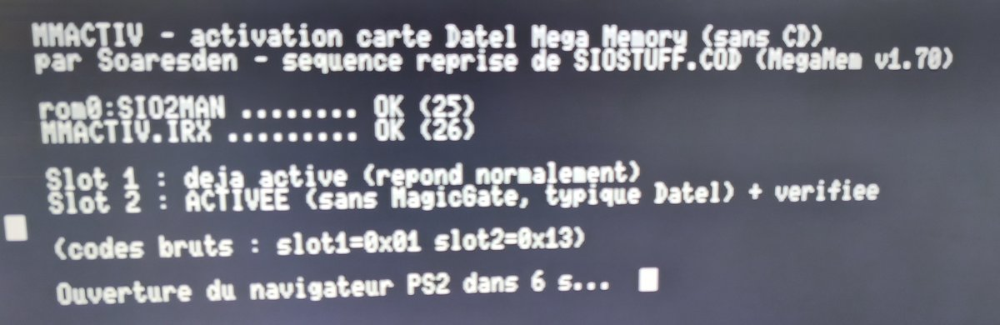
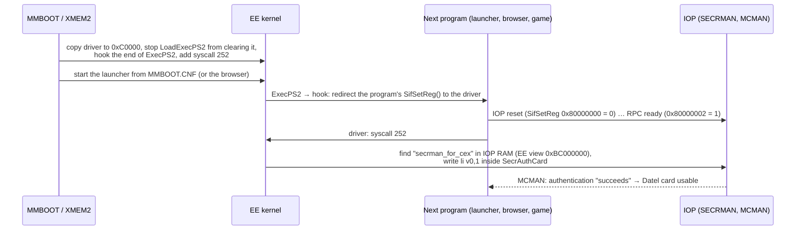

# bigben8mcps2 — reviving the Datel / Big Ben *Mega Memory 8* PS2 memory card, without its disc

<p align="center">
  
</p>

In 2001, **Datel** (sold in France by **Big Ben Interactive**) released the **Mega Memory 8**: a translucent purple
8 MB PS2 memory card bundled with a CD labelled *"Puissant gestionnaire de mémoire — Ceci n'est pas un jeu"*
(*MegaMem Program v1.70*). Plug the card in a PS2 on its own and **the console does not see it**. You had to boot the
CD first, every single time you powered the console on.

25 years later my disc was scratched, the card was useless, and nobody had ever documented how the thing worked.
So we reverse-engineered the whole thing. This repository contains:

| | What | For whom |
|---|---|---|
| **`bin/XMEM2.ELF`** | A complete memory card manager that **replaces the Datel CD**: sees the Datel card, **opens Datel's own X-MEM archives and restores the saves hidden inside**, copies/moves saves between slots, compresses saves into safe archives, imports/exports `.psu` on USB, 3D animated icons. | Everyone with a Datel card (works with Sony cards too) |
| **`bin/MMBOOT.ELF`** | **Plays the role of the CD.** Installs a small **resident driver** (clean-room reimplementation of Datel's trick), then starts **your launcher** (OPL, wLaunchELF, Neutrino...) after a countdown, or shows a **menu of every ELF found** on cards / USB / exFAT HDD with favourites and auto-boot. The Datel card then works in the browser **and in games**, until power-off. | Make it your PS2BBL / FMCB / OSDMenu **auto-boot** entry |
| **`bin/megamem_secrpatch.irx`** | The core trick as a stand-alone IOP module, for homebrew developers and loaders. ⚠️ Lost as soon as another program starts: [read why](#why-an-elf-and-not-just-an-irx). | Developers |
| `bin/tools/MMDUMP.ELF` | Dumps a whole card (raw, with ECC) to USB, read-only. | Backup / research |
| `bin/tools/MMDIAG.ELF` | Traces the MagicGate authentication packet by packet (Sony vs Datel). | Research |
| `pc-tools/datel_xmem_extract.py` | Recovers the saves **hidden by Datel's software** from a card dump and writes standard `.psu` files. | Anyone who used the "compress" feature back then |

Everything here is **our own code**. No Datel binary is included: see [Legal](#legal).

---

## Screenshots

| | |
|---|---|
|  |  |
| Save list with the save's **3D icon** rotating | Icons are real PS2 `.ico` models (animated shapes, textures) |
|  |  |
| Actions: copy, move, compress, export, delete | Compressed archive: SoulCalibur II, 134 KB → 39 KB |
|  |  |
|  | |
| **Datel X-MEM archive** opened on the console: 14 of 23 saves recoverable, restored byte-for-byte | |
| **MMBOOT**: favourites and auto-boot entry | **MMBOOT**: every ELF found on the cards, USB and exFAT HDD |

The interface follows the console language (English, or French on a French-configured PS2).
XMEM2 screenshots were taken in the [Play!](https://purei.org) emulator; the photos come from a real PAL "fat" PS2.

---

## Quick start

1. Copy `bin/XMEM2.ELF` (and `bin/MMBOOT.ELF`) to your memory card / USB drive and launch it from your loader
   (wLaunchELF, PS2BBL, FMCB, OSDMenu...).
2. **XMEM2**: `L1`/`R1` switch tabs (Slot 1, Slot 2, Archives 1, Archives 2, USB), `X` opens the action menu,
   `SQUARE` ticks several saves and `SELECT` ticks them all, so copy / move / compress / export / import / delete run
   as a batch,
   `START` → *Exit to the PS2 browser* keeps the Datel card working after you leave.
3. **MMBOOT**: copy `MMBOOT.ELF` to `mc0:/PS2BBL/` and make it the automatic entry in PS2BBL's `CONFIG.INI`
   (`LK_AUTO_E1 = mc?:/PS2BBL/MMBOOT.ELF`). At first boot its menu lists every ELF found: `TRIANGLE` = favourite,
   `SQUARE` = auto-boot (e.g. OPL). From then on: PS2BBL → MMBOOT (2 s countdown) → your launcher, with the driver
   installed; any button = menu, `R1` = PS2 browser. Full guide: [docs/MMBOOT.md](docs/MMBOOT.md).
4. **USB**: FAT32 or exFAT drive in the front port; `.psu` files live in `mass:/PS2SAVES/`.

Compressed archives are stored in a normal save folder called `XMEM2-ARCHIVES` (purple cube icon in the Sony
browser). Unlike Datel's format they are **real files**: nothing can overwrite them. Deleting that folder from the
Sony browser deletes all archives inside it.

---

## Why an ELF and not just an IRX?

A PS2 runs its drivers (`.IRX`) on a second processor, the **IOP**, and **the IOP is reset every time a program
starts**: an ELF, a game, OPL launching a game. Its memory is wiped and the new program loads its own drivers.
`megamem_secrpatch.irx` patches Sony's security module in IOP memory, so it disappears at the next launch.
(POPSTARTER's IRX files seem permanent only because POPSTARTER reloads them itself each time.)

What survives is the **EE kernel** memory. Datel's CD left a small driver there that re-applies the patch after
every IOP reset, until power-off. `MMBOOT.ELF` does the same, so it has to run **once after each power-on, before
everything else**, exactly like the CD had to. Put it on auto-boot with your launcher behind it and you never see it.

```
power on ─► MMBOOT (driver into the EE kernel) ─► OPL / wLaunchELF / browser ─► game ─► ...
                                                   every IOP reset: SECRMAN re-patched ✅
```

Details, and what is and isn't covered yet (games started by OPL/Neutrino are untested): [docs/MMBOOT.md](docs/MMBOOT.md).

---

## The short story

*(the long version, with every dead end, is in [docs/STORY.md](docs/STORY.md))*

1. **The disc was dying.** Windows Explorer froze on `BIG.DAT` (20 MB). IsoBuster rescued every file except that one.
   Disassembling the program showed `BIG.DAT` is **never referenced**: it is padding that pushes the data to the fast
   outer area of the disc. We rebuilt a working ISO without it.
2. **First theory: a secret activation command.** The card driver on the disc (`SIOSTUFF.COD`) sends `81 F7 01`, which Sony's
   memory card driver never sends. We replayed Datel's exact sequence (`MMACTIV`). The card answered, but the browser
   still ignored it.
   
3. **Dumping the card** (`MMDUMP`) showed a normal Sony file system with one visible folder, `X-MEM DATEL`, plus
   **23 compressed saves hidden as deleted files**. Datel's "compression" (LZARI) kept saves in space the PS2 considers
   free, so games had overwritten 9 of them. We decompressed the 14 survivors.
4. **Diagnosing the handshake** (`MMDIAG`): the Datel card **does not implement MagicGate at all**. It never answers
   the first authentication command (`81 F0 00`), while a Sony card answers all 21 steps. `F7 01` turned out to be a
   normal part of Sony's own sequence.
5. **The real trick.** The disc owner remembered one detail: *"after the CD, I could go back to the browser and the card
   was there."* So the program must leave something resident behind. It does. A small block of code at `0x000C0000`
   hooks the EE kernel, survives the return to the browser, and **after every IOP reboot it patches one instruction of
   Sony's security module (`SECRMAN`) so that `SecrAuthCard()` always succeeds.** The Datel card was never authenticated.
   Datel simply switched the check off.
6. We reimplemented that driver from scratch (`MMBOOT`, `megamem_secrpatch.irx`) and wrote the manager Datel should
   have shipped (`XMEM2`).

Full technical write-up: **[docs/REVERSE_ENGINEERING.md](docs/REVERSE_ENGINEERING.md)**.



---

## Recovering saves hidden by Datel's software

If you used the CD's compress feature, your saves are probably still on the card, invisible.

**On the console:** in XMEM2, select the `X-MEM DATEL` folder, press `X` → *Open the Datel archive*. Every hidden
save is listed (recoverable ones first); tick the ones you want (`SQUARE`, or `SELECT` for all) and restore them to
the other slot or export them to USB in one go. The Datel card is only
read, never written (raw reads go through XMEM2's own read-only module, `src/xmraw`).

**On a PC:**

```sh
# 1. dump the card on the PS2 with bin/tools/MMDUMP.ELF  -> mass:/BAKMEGAMEMORYMC/MEGAMEM_SLOT2_00.mcd
# 2. on a PC:
python3 pc-tools/datel_xmem_extract.py MEGAMEM_SLOT2_00.mcd recovered/
# 3. import the .psu files with XMEM2 (USB tab), wLaunchELF, or PCSX2 / mymcplus
```

On our card, 14 of the 23 hidden saves were recovered byte-for-byte (GTA III, Dark Cloud, SoulCalibur II,
Half-Life, Red Faction I & II, Burnout 2, DBZ Budokai 2...). The 9 others had their first cluster overwritten.
LZARI cannot resume mid-stream, so those are gone.

---

## Status / compatibility

| Item | Status |
|---|---|
| Card dump, save recovery, diagnosis (MMDUMP, MMDIAG, PC tool) | ✅ real PS2 (PAL fat, PS2BBL) |
| Datel resident trick (original code, used as a reference) | ✅ real PS2: card visible in the browser |
| XMEM2 UI, 3D icons, copy / compress / restore (byte-identical) | ✅ Play! emulator — ⏳ real PS2 test pending |
| Clean-room resident driver (MMBOOT, XMEM2 "exit to browser") | ⏳ real PS2 test pending |
| MMBOOT menu (ELF scan, favourites, auto-boot) + chain-loading a launcher | ✅ Play! emulator — ⏳ real PS2 test pending |
| Datel card in games started by OPL / Neutrino | ❓ untested (see [docs/MMBOOT.md](docs/MMBOOT.md#what-is-covered-what-isnt-yet)) |
| USB import/export | ⏳ real PS2 test pending (not emulated by Play!) |
| XMEM2: opening Datel X-MEM archives on the console | ✅ decoder checked against the real card dump (14/14 saves byte-identical) and in Play! — ⏳ raw page read (XMRAW.IRX) on real PS2 pending |

The SECRMAN patch uses the same fixed offset as Datel's disc (`name − 0x2BA0`), so it targets the SECRMAN of
2000–2002 consoles. The resident driver refuses to patch unless the target lies inside `SecrAuthCard`
(checked through the module's export table). Games that ship their own SECRMAN are left untouched.
Reports from other consoles and BIOS versions are very welcome: open an issue with your model (SCPHxxxxx) and the
`About` screen of XMEM2 or the MMBOOT screen.

---

## Building

Everything builds with the official ps2dev toolchain:

```sh
./build.sh docker        # uses the ps2dev/ps2dev Docker image
# or, inside a toolchain shell:
./build.sh
```

Details in [docs/BUILDING.md](docs/BUILDING.md). MMBOOT: [docs/MMBOOT.md](docs/MMBOOT.md). IRX usage for developers: [docs/IRX.md](docs/IRX.md).
Archive format: [docs/XMM2_FORMAT.md](docs/XMM2_FORMAT.md).

---

## Legal

* This project is not affiliated with Datel, Big Ben Interactive or Sony. *Mega Memory*, *MegaMem* and *X-MEM* are
  trademarks of Datel Design & Development Ltd. *PlayStation* is a trademark of Sony Interactive Entertainment.
* **No Datel code or data is distributed.** The disc's files are described (names, sizes, SHA-1) so you can identify
  your own copy, never redistributed. The resident driver is a clean-room reimplementation written from the behaviour
  documented in [docs/REVERSE_ENGINEERING.md](docs/REVERSE_ENGINEERING.md).
* Reverse engineering was done for interoperability, on hardware and software I own, to keep using a card I bought.
* Use at your own risk. The tools that write to cards ask for confirmation before overwriting or deleting.

## Credits

* **Soaresden**: the card, the scratched disc, the hardware tests, and the stubbornness.
* Reverse engineering and code written together with **Claude** (Anthropic).
* Built on **ps2sdk**, **gsKit** and **zlib**. Icon font: DejaVu Sans. LZARI by Haruhiko Okumura (1989).
* Thanks to the ps2dev community, **mymcplus** for the reference memory card tooling, and **Play!** for being scriptable
  enough to test a GUI headlessly.

License: [MIT](LICENSE).
