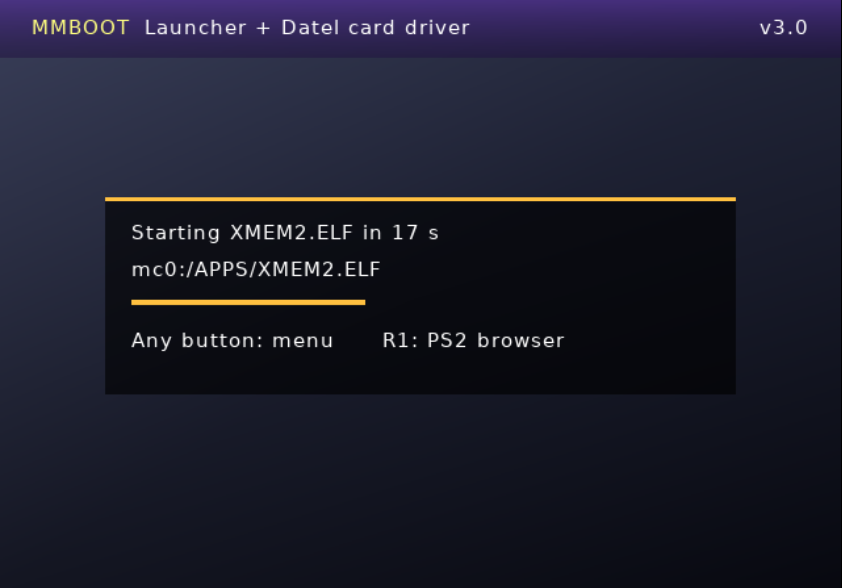

# MMBOOT: the CD, without the CD

`MMBOOT.ELF` does what the Datel disc did at every power-on, then gets out of the way:

1. it installs the **MegaMem resident driver** (our clean-room reimplementation of Datel's trick) in a corner of
   EE memory that survives program changes (`0x000C0000`);
2. it starts **your launcher** (OPL, wLaunchELF, Neutrino, your own menu...) after a short countdown, or shows a
   small **menu listing every ELF** it finds on the memory cards, USB drives and exFAT HDD, where you pick your
   favourites and the auto-boot entry.

From then on and **until the console is switched off**, every time a program resets the IOP, the driver switches
off the MagicGate check again, and the Datel card keeps working, whatever you launched.

| | | |
|---|---|---|
|  |  |  |
| Auto-boot countdown: any button opens the menu, R1 the PS2 browser | **Favourites** tab (always starts with the PS2 browser) | **All ELF files** tab: everything found, `FAV` / `AUTO` badges |

*(screenshots from the Play! emulator)*

## The menu

| Button | Action |
|---|---|
| `X` / `START` | install the driver and launch the selected program |
| `TRIANGLE` | add / remove the selected ELF to/from the **favourites** |
| `SQUARE` | make it the **auto-boot** entry (again on the same entry = no auto-boot: menu at every power-on) |
| `L1` / `R1` | switch between *Favourites* and *All ELF files* |
| `SELECT` | scan again (after plugging a USB drive, for example) |
| `LEFT` / `RIGHT` | page up / down |

Favourites and auto-boot are saved immediately in `MMBOOT.CNF`; you never have to edit the file by hand.

The green line above the buttons shows the **driver counters since power-on** (launch MMBOOT again, without switching
off, after trying something): `prog` = programs started through `ExecPS2`, `stubs` = `SifSetReg` stubs redirected,
`reset a/b` = IOP reboots seen through the stubs / through the kernel hook, `patchs` = SECRMAN patches applied,
`last` = result of the last patch (`OK`, `SECRMAN not found`, `refused`).

What is scanned: the root and every folder of both memory cards; the root and two levels of folders on every
`mass` drive (`mass:/X.ELF`, `mass:/APPS/X.ELF`, `mass:/APPS/OPL/X.ELF`), skipping game and data folders (`DVD`,
`CD`, `ART`, `VMC`, `CFG`, `THM`, `CHT`, `LNG`, `PS2SAVES`...). Paths on `mass` drives are saved as `mass?:` because a
USB drive and an exFAT HDD can swap unit numbers from one boot to the next.

---

## Why an ELF? Why isn't the IRX enough?

This is the question everybody asks (I did too), so here is the long answer.

A PS2 has two processors:

* the **EE** (Emotion Engine) runs the game or the homebrew;
* the **IOP** (the old PS1 processor) runs the drivers: memory cards, pads, USB, disc... These drivers are the
  `.IRX` modules.

**Every time a new program starts (an ELF, a game, OPL launching a game), the IOP is reset.** Its RAM is wiped and
the new program loads *its own* list of modules. Whatever an IRX did before is gone. That is by design: each game
wants a clean IOP with the exact modules it was tested with.

`megamem_secrpatch.irx` patches Sony's `SECRMAN` module **in IOP RAM**. So it only lives until the next IOP reset:

```
power on ─► PS2BBL (+ LOAD_IRX secrpatch)  ─►  launch OPL / a game / an ELF
            IOP: SECRMAN patched ✅              IOP reset ─► fresh SECRMAN ❌  (patch lost)
```

"But POPSTARTER's IRX files stay on the drive and work every time!" They do, because POPSTARTER **loads them itself**,
every time it starts a game. A game disc or OPL has no idea our IRX exists, so nobody would load it again.

The IOP cannot remember anything across a reset, but the **EE kernel** can: its memory is not wiped when programs
change. That is exactly what Datel did, and what MMBOOT does:

```
power on ─► MMBOOT: driver copied into the EE kernel area, ExecPS2 hooked
         ─► launcher / browser ─► game ─► ...
             each time a program is started   : the hook redirects its SifSetReg() calls to the driver
             each time that program resets IOP: the driver re-patches the new SECRMAN   ✅ ✅ ✅
power off ─► everything is gone (nothing is ever written to the console)
```

So **MMBOOT is the "CD"**: it has to run once after each power-on, before anything that should see the Datel card.
The easy way is to make it your **auto-boot** entry, with your real launcher behind it (below). Then you never think
about it again.

The IRX remains useful for developers and for programs that load their own modules (a homebrew that wants to read a
Datel card: see [IRX.md](IRX.md)).

---

## Setting it up with PS2BBL

1. Copy `MMBOOT.ELF` to `mc0:/PS2BBL/` (any folder works: MMBOOT keeps its `MMBOOT.CNF` next to itself).
2. Launch it once: the menu lists every ELF found. Put the cursor on your launcher (say OPL) and press `SQUARE`
   to make it the auto-boot entry, `TRIANGLE` on the ones you want as favourites. The sample `bin/MMBOOT.CNF`
   shows the same thing done by hand:

   ```ini
   BOOT = mass?:/APPS/OPNPS2LD.ELF
   FAV  = mass?:/APPS/OPNPS2LD.ELF
   FAV  = mc?:/BOOT/BOOT.ELF
   ```
3. In `mc0:/PS2BBL/CONFIG.INI`, make MMBOOT the automatic entry, and keep your usual launchers on the keys:

   ```ini
   LK_AUTO_E1  = mc?:/PS2BBL/MMBOOT.ELF
   LK_START_E1 = mass:/APPS/OPNPS2LD.ELF
   ```

Power on: PS2BBL → MMBOOT (2-second countdown) → OPL, with the driver installed. Press any button during the
countdown for the menu, or hold **R1** for the PS2 browser.
FMCB / OSDMenu work the same way: put MMBOOT where the auto-launch item is.

## MMBOOT.CNF reference

| Key | Meaning |
|---|---|
| `BOOT = path` | Auto-boot entry. Several lines = fallbacks, the first one found is used. `BROWSER` = PS2 browser. No `BOOT` line = menu at every boot. |
| `FAV = path` | A favourite (one line each), shown in the *Favourites* tab. |
| `HDD = 1` | Load the internal HDD driver (`ps2dev9` + `ata_bd`) so an **exFAT/FAT32** HDD appears as a `mass?:` drive. Default 1; `HDD = 0` skips it. |
| `USB_WAIT = 5` | Seconds to wait for USB/HDD drives to be mounted before moving to the next `BOOT` line. |
| `DELAY = 2` | Countdown before the auto-boot entry (time to press a button). |

Paths: `mc0:/`, `mc1:/`, `mc?:/` (tries both), `mass:/` (first drive), `mass0:/`..`mass4:/`, `mass?:/` (tries all:
use this when both a USB drive and an exFAT HDD are connected, since the order they get mounted in is not fixed).
Config search order: next to `MMBOOT.ELF`, `mc0:/MMBOOT/`, `mc1:/MMBOOT/`, `mc0:/PS2BBL/`, `mc1:/PS2BBL/`,
`mass:/MMBOOT/`, `mass:/PS2BBL/`. MMBOOT loads the card patch for itself too, so the config (and the launcher)
can even live **on the Datel card**.

No config, no `BOOT` line, or auto-boot entry not found → the menu opens. When MMBOOT has to create the file, it
writes it next to itself, else in `mc0:/PS2BBL/`, else in `mc0:/MMBOOT/`.

---

## What is covered, what isn't (yet)

The driver catches IOP resets that a program performs **through the standard Sony/ps2sdk library call**
(`SifSetReg`), which is how the browser, commercial discs, wLaunchELF and almost all homebrew do it. It's the same
mechanism as Datel's disc, so it covers what the disc covered.

| Started after MMBOOT | Datel card visible? |
|---|---|
| PS2 browser, game discs started from the browser | ✅ expected (same mechanism as the Datel disc, proven on hardware with Datel's own driver) |
| wLaunchELF, XMEM2, homebrew ELFs, launcher menus (OPL/NHDDL menu itself) | ✅ expected (standard IOP reset) |
| Games started **by OPL / Neutrino** | ❓ unknown. These loaders run the game with their own IOP-reset code, which may bypass the hook. Reports welcome. |
| POPSTARTER (PS1 games) | not relevant: PS1 games use POPSTARTER's virtual memory cards |

Datel already hit this limit: for one game (`SLES_505.39` / `SLUS_202.65`) whose code doesn't use the usual
`SifSetReg` stub, its driver had a second mode that hooks syscall 121 (`SifSetReg`) directly in the kernel
([REVERSE_ENGINEERING.md](REVERSE_ENGINEERING.md#5-the-resident-hook)). If OPL/Neutrino games turn out not to see the
card, that is the next thing to implement.

Status: menu, scan, favourites/auto-boot saving and chain-loading tested in the Play! emulator; hardware test pending. If something doesn't work,
open an issue with the MMBOOT screen (a photo is fine), your console model (SCPHxxxxx) and the launcher used.

## Technical notes

* The interface reuses XMEM2's renderer (gsKit) and font, and follows the console language (English / French).
* MMBOOT resets the IOP, loads `SIO2MAN`, the SECRMAN patch, `MCMAN/MCSERV`, `PADMAN`, and the ps2sdk
  `iomanX/fileXio/usbd/bdm/bdmfs_fatfs/usbmass_bd` modules (plus `ps2dev9/ata_bd` with `HDD = 1`), all embedded.
* The launcher is started with ps2sdk's `LoadELFFromFile()`: a small loader at `0x94000` reads the ELF and calls
  `ExecPS2`, which runs through our hook. The resident driver at `0x000C0000` is outside both.
* Since v3 the driver also replaces the kernel's `SifSetReg` syscall (0x79) handler, like Datel's special mode for
  one game. That catches **packed ELFs** (ps2-packer: wLaunchELF, OPL...), whose real code and `SifSetReg` stubs only
  appear after the `ExecPS2` scan, and loaders that reset the IOP with their own code.
* The driver is installed only when something is launched, and installing it twice is harmless (the second time
  just refreshes it). If it can't be installed (unknown kernel, or an emulator), MMBOOT says so and asks before
  launching anyway.
