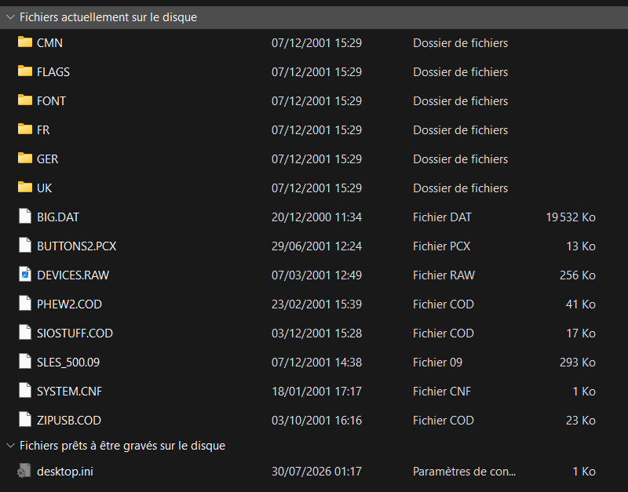

# The story: how a scratched disc turned into a reverse-engineering project

## 0. The card

Early 2000s. Next to the fat PS2 there is a **translucent purple memory card**: a *Mega Memory 8* by Datel,
sold in France by Big Ben Interactive. The box promises a *"powerful memory manager giving you total control over your
game saves"* and ships a CD: **MegaMem Program v1.70** (`SLES_500.09`), clearly marked *"Ceci n'est pas un jeu"*
(*"This is not a game"*).

The routine back then was:

* Card alone in the PS2: **the console does not see it**.
* Boot the CD, an ugly menu appears, and the card is there. You can manage your saves, and even go back to the Sony
  browser, where the card is now visible and usable.
* Or: boot the CD, it asks you to swap in your game disc and press START, and the game can use the card.

Every cold boot, the CD again.

## 1. 2026: the disc is dying

The disc comes back from a family house. Windows can list its files but freezes while copying them. The drive audibly
struggles.

The files are small, except one: **`BIG.DAT`, 19 532 KB**, dated a year before everything else. **IsoBuster** did the
job: every file came back, except `BIG.DAT` (LBA 25 → 4398 unreadable).

**Dead end avoided:** disassembling `SLES_500.09` showed that `BIG.DAT` is **never referenced**, by the program or by
any of its modules. It is a **padding file** placed at the start of the disc, which pushes the real data towards the
outer edge where reads are faster. A standard trick of the time. The ISO was rebuilt without it and it boots.

The disc also contains:

* `SIOSTUFF.COD`: an IOP module (IRX), the memory card driver of the manager.
* `PHEW2.COD`: a USB driver (`usbd`). `ZIPUSB.COD`: an Iomega Zip / USB mass storage driver. The manager could back up
  saves to a Zip drive!
* Graphics (`.PCX`, `.RAW`), fonts, and FR/GER/UK language folders.

## 2. First theory: a secret activation command

`SIOSTUFF.COD` still had its symbol table, and its SIO2 packets could be read directly from the disassembly. Its
"probe" routine does: `81 11` (probe); if the card does not answer, `81 F3 00` (reset auth), **`81 F7 01`**, then
`SecrAuthCard()` (Sony's MagicGate authentication), then `81 28`, `81 27 5A`, `81 26 5A` (card specs).

Sony's own driver (MCMAN, as re-implemented in ps2sdk) never sends `F7 01`. That looked like the secret handshake. So
we wrote **MMACTIV** ([`src/tools/mmactiv`](../src/tools/mmactiv)), which replays Datel's exact sequence, as an ELF and as an IRX for PS2BBL.

It answered, *"activated without MagicGate + verified"*. Yet the Sony browser still did not show the card.
**Wrong theory.**

## 3. Plan B: get the data out

Since the card talks when it is driven directly, we wrote **MMDUMP**. It activates the card and reads all 16 384 pages
(512 bytes + 16 bytes of ECC each) with Datel's own read sequence (`81 23` address, 4× `81 43 80`, `81 43 10`,
`81 81`), then writes an 8 MB `.mcd` image to USB. Zero read errors, zero checksum warnings.

The image turned out to be a perfectly normal **Sony file system**, holding:

* `BEDATA-SYSTEM` (the browser's history file),
* `BESLES-00000 X-MEM`: Datel's folder, with its X-MEM cube icon,
* ...and inside X-MEM, **23 entries flagged as deleted**, named after games: `BESLES-51839DBZ2`,
  `BESLES-50330GTA30000`, `BESLES-52541GTA50000`...

That is Datel's "Mega Memory": the manager **compresses** saves (the algorithm turned out to be **LZARI**, by
Haruhiko Okumura, 1989, recognisable by its constants 314 / 4036 / 10000 / 200 in the executable) and stores them as
files that the PS2 believes are deleted. They don't count as used space, and that is how 8 MB becomes "more".
The catch: **any game saving later can overwrite them**. And games did.

The FAT still holds the cluster chains (only the "allocated" bit is cleared), so they can be followed. Result:
**14 saves out of 23 recovered byte-for-byte**. GTA III, Dark Cloud, SoulCalibur II, Half-Life, Red Faction I & II,
Burnout 2, DBZ Budokai 2, NFS Hot Pursuit 2, 007 NightFire, The Getaway, Crazy Taxi, Smash Court Tennis, Leisure Suit
Larry. The other 9 (including GTA Vice City and San Andreas) had their first cluster overwritten. LZARI is an
arithmetic coder and cannot restart in the middle of a stream, so they are lost.
Tool: [`pc-tools/datel_xmem_extract.py`](../pc-tools/datel_xmem_extract.py).

## 4. "The card has no MagicGate": right fact, wrong conclusion

**MMDIAG** logs every packet during the authentication, first for a Sony card, then for the Datel card
([full log](logs/MMDIAG_LOG.TXT)):

* It turns out `81 F7 01` is sent by **Sony's own SECRMAN**, to every card. It was never Datel's secret.
* The Sony card answers all 21 MagicGate steps (`81 F0 00` → `81 F0 14`) with encrypted data.
* The Datel card acknowledges the reset, then goes **completely silent** at `81 F0 00`. The SIO2 reports a timeout
  and the Sony code gives up.

So the Datel card does not implement MagicGate at all. The conclusion at that point was: *"then games could never have
used it; it was only a storage device for the manager."*

## 5. The real trick

The card's owner disagreed, and he was right: *"After booting the CD I could go back to the **browser** and the card was
there, and I could use it in games."* If the browser, which uses Sony's own driver, accepted the card after the CD,
then the CD must leave something **resident** behind.

Back to the executable. `SLES_500.09` has a small first segment loaded at `0x000C0000`, separate from the main program
at `0x00800000`. That segment is a complete **EE kernel hook**:

1. It adds two syscalls (read and write kernel memory), finds the kernel's syscall table, and **patches the end of
   `ExecPS2`** so that every program started afterwards (the browser, a game) first goes through Datel's code.
2. It patches `LoadExecPS2` so that the memory at `0x82000–0x102000` is no longer wiped. The hook survives.
3. In every newly loaded program it finds the `SifSetReg` system call stub and redirects it.
4. When the program resets the IOP and the IOP reboots (`SifSetReg(0x80000000, 0)` … `SifSetReg(0x80000002, 1)`), it
   binds the IOP's LOADFILE RPC, **searches IOP memory for the module named `secrman_for_cex`**, and writes `li v0,1` at
   `name − 0x2BA0`.

That single instruction makes **`SecrAuthCard()` return "success"**. Sony's MCMAN then happily uses the Datel card,
which never authenticated anything. The mysterious purple card was just a plain flash card, and the CD's real job was
to **switch off the console's copy-protection check** after every IOP reboot.

We copied that block from the disc into a tiny launcher to prove it:

*Memory Card (PS2)/2 — X-MEM DATEL.* The card was back, without the disc, for the first time in 25 years.

## 6. Doing it properly

Shipping Datel's code is not an option for a public repository. So everything was rewritten from the documented
behaviour:

* **`megamem_secrpatch.irx`**: the patch as an IOP module. It scans for the module name, checks the target
  lies inside `SecrAuthCard` using the `secrman` export table, patches, and flushes the IOP instruction cache.
* **The resident driver** (`src/resident`), used by **MMBOOT** and by XMEM2's *Exit to browser*. The idea is Datel's,
  the code is new. Instead of an RPC to LOADFILE, the IOP RAM is patched directly through the EE's view of it at
  `0xBC000000`, from a kernel-mode syscall. The displaced kernel instructions are copied instead of hard-coded, and the
  patch is refused if the target is not inside `SecrAuthCard`, which protects games that ship their own SECRMAN.
* **XMEM2**, the manager Datel should have shipped: list, copy/move between slots, compress into **real,
  protected archive files** (zlib + CRC32, often 3–5× smaller, and unlike Datel's never overwritten), `.psu`
  import/export over USB, and animated 3D icons rendered from the saves' own `.ico` models. After the first console
  test, Denis pointed out the obvious gap: *"it didn't notice that X-MEM is Datel's zip, with my saves inside!"* So
  XMEM2 now opens the X-MEM folder itself, reads the "deleted" archives page by page and restores them, like the PC
  tool does.

## 7. "Can't the IRX just stay loaded?"

The first question once the IRX existed: *POPSTARTER's IRX files sit on my drive and work every time, why not this
one?* Because every program that starts resets the IOP and wipes its memory, and POPSTARTER simply reloads its own
IRX files at each launch. A game disc or OPL will never load ours. The only memory that survives a program change is
the EE kernel's, which is exactly why Datel needed a CD at every power-on and left a resident hook behind.

So the answer was to make MMBOOT behave like the CD **and** get out of the way: it now reads `MMBOOT.CNF`,
installs the driver, and starts the user's real launcher (OPL, wLaunchELF, any ELF) instead of the browser. Set as
PS2BBL's auto-boot entry, it runs for two seconds at power-on and is never seen again. Denis then asked for the
obvious next step: *"can't it just list the ELFs so I pick the ones I care about?"* So MMBOOT got a small menu,
with the same look as XMEM2, that scans the cards, USB drives and exFAT HDD for ELF files, and lets you mark
favourites and the auto-boot entry with one button. See [MMBOOT.md](MMBOOT.md).

## Lessons

* Look for padding before mourning an unreadable file.
* A symbol table left in a driver is a gift.
* When the data contradicts a user's memory, re-check the data before telling the user they're wrong.
* Datel's "memory card" was really a patch for Sony's security check, shipped on a CD.
* On a PS2, a driver is only as permanent as whoever reloads it: across program launches, only the EE kernel remembers.
